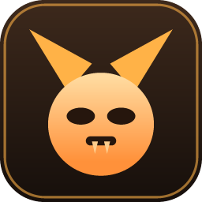
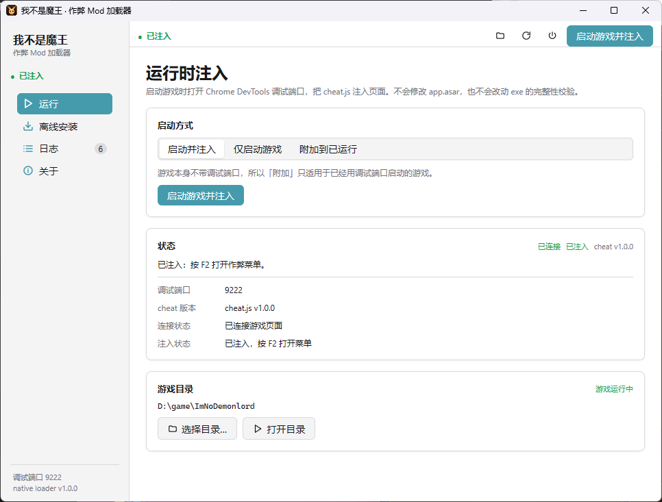
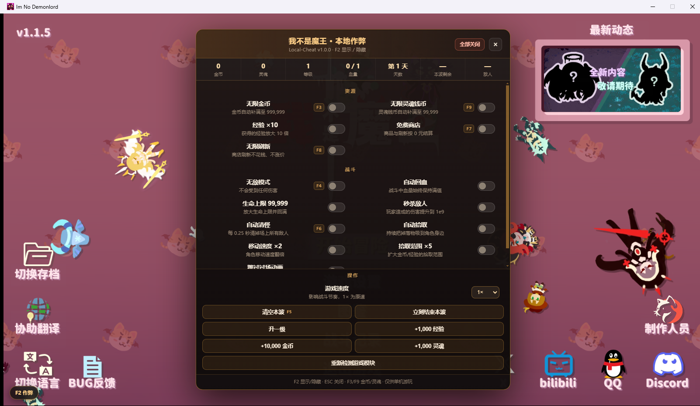
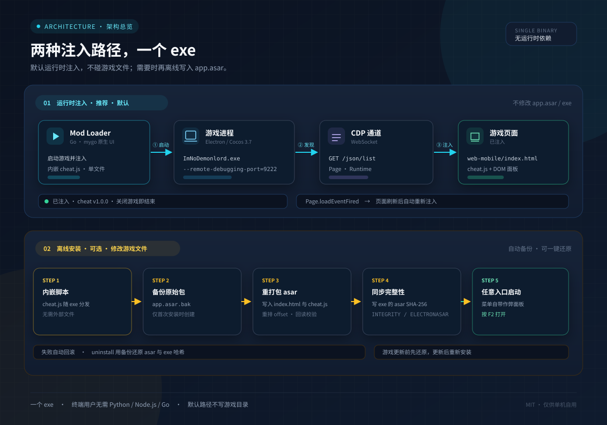
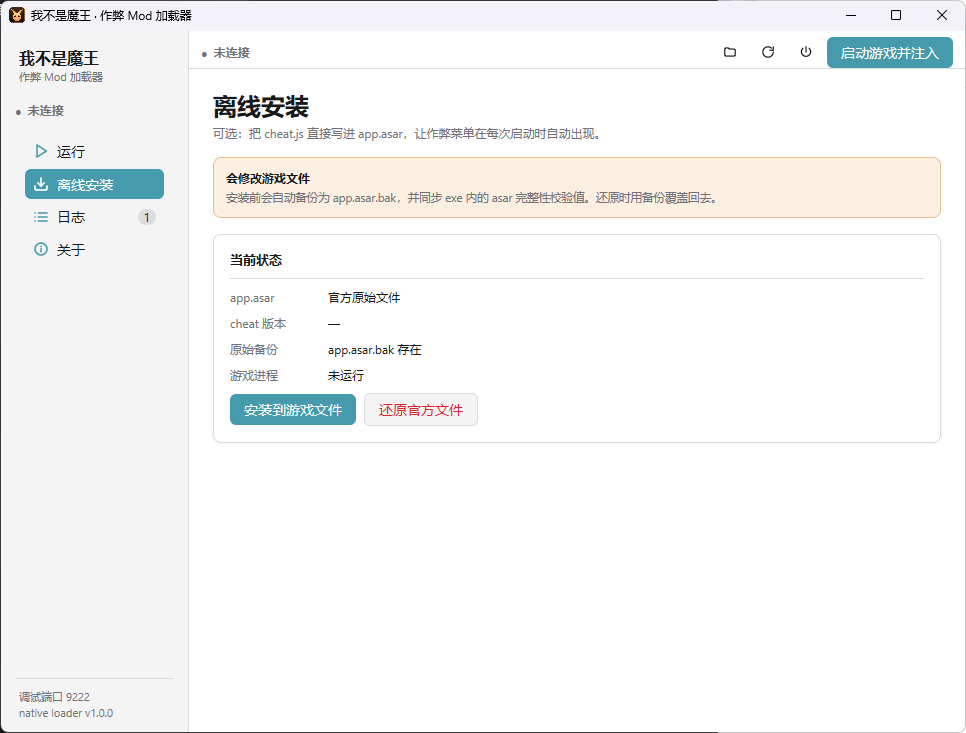
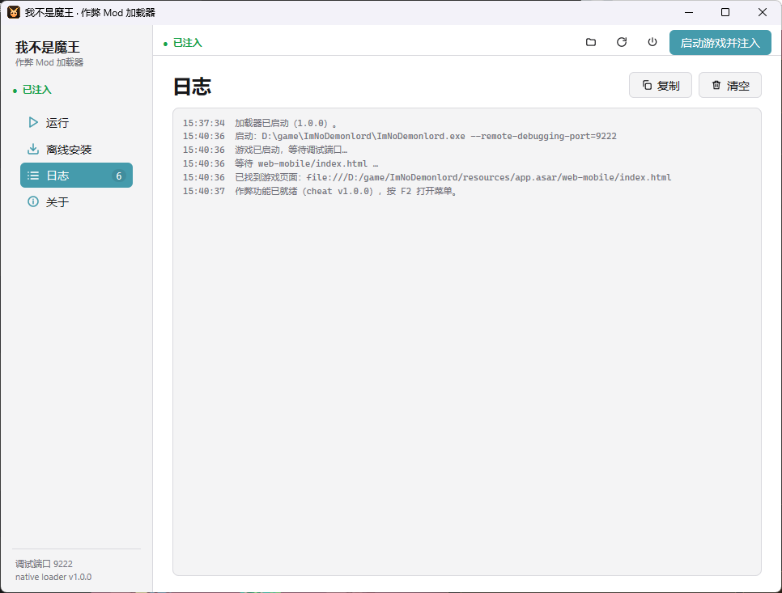
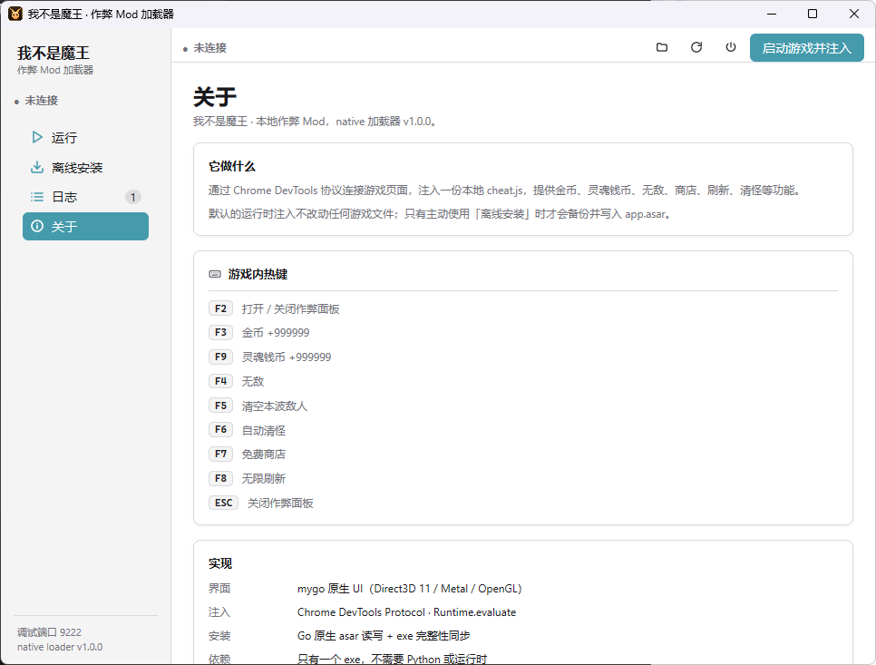

# 我不是魔王 · 本地作弊 Mod

<p align="center">
  
</p>

<p align="center">
  <strong>《我不是魔王》Electron 版的中文本地作弊 Mod</strong><br>
  运行时注入，不碰游戏文件；需要时也能离线装进 <code>app.asar</code>。
</p>

<p align="center">
  <a href="https://github.com/yviscool/im-no-demonlord-mod/actions/workflows/build.yml"></a>
  <a href="https://github.com/yviscool/im-no-demonlord-mod/releases"></a>
  <a href="LICENSE"></a>
</p>

<p align="center">
  
</p>

<p align="center">
  <sub>加载器「运行」页：启动游戏、通过 CDP 注入，连接状态与 cheat 版本实时显示。</sub>
</p>

一份运行在游戏页面里的 `cheat.js`，加上一个用 Go + [mygo](https://github.com/egoist/mygo) 原生 UI 写的加载器。

- **默认不改游戏文件**：用 Chrome DevTools 协议把脚本注入正在运行的游戏。
- **只有一个 exe**：终端用户不需要 Python、Node.js 或任何运行时。
- **中文面板**：游戏内按 `F2` 打开，功能按需开启，关闭即还原。
- **可还原的离线安装**：也可以把脚本写进 `app.asar`，自动备份并同步 exe 的完整性校验值。

> 仅供单机娱乐与学习。使用前请自行备份存档；联机或涉及他人数据时请关闭全部功能。

## 游戏内面板

<p align="center">
  
</p>

<p align="center">
  <sub>按 <code>F2</code> 呼出面板：顶部是实时资源与波次状态，中间按「资源 / 战斗 / 操作」分组，底部是一键操作。</sub>
</p>

| 分组 | 功能 |
| --- | --- |
| 资源 | 无限金币、无限灵魂钱币、经验 ×10、免费商店、无限刷新 |
| 战斗 | 无敌、自动回血、生命上限 99,999、秒杀、自动清怪、自动拾取、移动速度 ×2、拾取范围 ×5、跳过过场动画 |
| 操作 | 游戏速度调节、清空本波、立即结束本波、升一级、加金币 / 灵魂、重新检测模块 |

所有开关都是运行时的函数钩子：关闭后立刻恢复游戏原本的数值与行为。面板本身是叠加在 Cocos 画布之上的 DOM，不参与游戏渲染。

## 快速开始

1. 到 [Releases](https://github.com/yviscool/im-no-demonlord-mod/releases) 下载最新的 `ImNoDemonlord-LocalCheat-v*.zip` 并解压。
2. 双击 `ImNoDemonlord-ModLoader.exe`。
3. 如果没自动找到游戏，点「运行 → 选择目录…」，选中包含 `ImNoDemonlord.exe` 和 `resources\app.asar` 的游戏根目录。
4. 点主按钮「启动游戏并注入」，等状态变成 **已注入**。
5. 在游戏里按 `F2` 打开作弊面板。

建议把加载器解压到游戏目录里，这样它能自动定位游戏：

```text
D:\game\ImNoDemonlord\
├─ ImNoDemonlord.exe
├─ resources\app.asar
└─ ImNoDemonlord-LocalCheat\
   ├─ ImNoDemonlord-ModLoader.exe
   ├─ install.bat
   ├─ uninstall.bat
   └─ start-loader.bat
```

## 两种使用方式

<p align="center">
  
</p>

### 运行时注入（推荐）

加载器用 `--remote-debugging-port=9222` 启动游戏，通过 CDP 找到 `web-mobile/index.html` 页面并注入脚本。页面刷新或重新加载后会自动重新注入。

- 不修改 `app.asar`，不改动 exe。
- 关闭加载器或游戏后不留下任何改动。
- 需要由加载器启动游戏（游戏本身不会打开调试端口）。

### 离线安装（可选）

把 `cheat.js` 直接写进 `resources\app.asar`，之后从任何入口启动游戏都会自带作弊菜单。

<p align="center">
  
</p>

<p align="center">
  <sub>「离线安装」页会先检查游戏是否在运行，并展示 asar 与备份状态。</sub>
</p>

- 首次安装自动把原始包备份为 `app.asar.bak`。
- 会同步 `ImNoDemonlord.exe` 中 `INTEGRITY/ELECTRONASAR` 资源的 asar 哈希，否则 Electron 会拒绝启动。
- 安装前会回读校验；写 exe 失败会自动回滚 asar。
- 点「离线安装 → 还原官方文件」即可恢复。

## 加载器界面

<table>
  <tr>
    <td width="50%"></td>
    <td width="50%"></td>
  </tr>
  <tr>
    <td align="center"><sub>日志：从启动参数到注入完成，每一步都有时间戳。</sub></td>
    <td align="center"><sub>关于：内置热键表与实现说明，不用翻文档。</sub></td>
  </tr>
</table>

左侧导航分为 **运行 / 离线安装 / 日志 / 关于**。顶部工具栏提供打开游戏目录、断开并重连、关闭全部作弊和主操作按钮；窗口位置、大小与最大化状态会被记住。

## 热键

| 按键 | 功能 |
| --- | --- |
| `F2` | 打开 / 关闭作弊面板 |
| `F3` | 金币 +999,999 |
| `F9` | 灵魂钱币 +999,999 |
| `F4` | 无敌 |
| `F5` | 清空本波敌人 |
| `F6` | 自动清怪 |
| `F7` | 免费商店 |
| `F8` | 无限刷新 |
| `ESC` | 关闭面板 |

## 命令行

```bat
ImNoDemonlord-ModLoader.exe                     :: 打开图形界面（默认）
ImNoDemonlord-ModLoader.exe status              :: 查看游戏、备份和安装状态
ImNoDemonlord-ModLoader.exe install             :: 离线安装（自动备份）
ImNoDemonlord-ModLoader.exe uninstall           :: 用 app.asar.bak 还原
ImNoDemonlord-ModLoader.exe inject              :: 启动游戏并注入，无界面
ImNoDemonlord-ModLoader.exe inject -attach      :: 注入到已开启调试端口的游戏
ImNoDemonlord-ModLoader.exe inject -once        :: 注入成功后退出
```

通用参数：`-game <目录>`、`-port <端口>`。完整说明见 [docs/LOADER.md](docs/LOADER.md)。

批处理入口：

- `start-loader.bat`：无窗口启动加载器。
- `install.bat`：离线安装，等价于 `install`。
- `uninstall.bat`：还原官方文件，等价于 `uninstall`。

## 从源码构建

需要 Windows 10/11 x64 与 Go 1.27.3 或更高版本。

```bat
git clone https://github.com/yviscool/im-no-demonlord-mod.git
cd im-no-demonlord-mod
build.bat        :: 只构建 dist\ImNoDemonlord-ModLoader.exe
package.bat      :: 构建并打包 dist\ImNoDemonlord-LocalCheat-v*.zip
```

- `build.bat` 会把 `src\cheat.js` 同步到 `loader\assets\cheat.js`（`go:embed` 需要）。
- exe 使用 `-H=windowsgui` 链接，双击不会出现控制台窗口；CLI 子命令会自动附加到调用它的终端。
- 图标和版本资源已提交为 `loader\rsrc_windows_amd64.syso`。修改图标后运行 `tools\make_winres.bat` 重新生成（需要 `go install github.com/tc-hib/go-winres@latest`）。
- 仓库没有任何 Python 脚本，构建、图标生成和打包全部使用 Go / 批处理。

## 目录结构

```text
├─ src\cheat.js                游戏内脚本（面板、钩子、热键）
├─ loader\                     Go 加载器（mygo 原生 UI + CDP + asar）
│  ├─ main.go                  子命令与窗口
│  ├─ ui.go                    原生界面
│  ├─ app.go                   注入循环与状态
│  ├─ cdp.go                   最小 CDP WebSocket 客户端
│  ├─ asar.go                  asar 读写与 exe 完整性同步
│  ├─ console_windows.go       GUI 子系统下的终端附加
│  └─ assets\                  cheat.js、图标
├─ tools\icongen\              图标生成器
├─ tools\package\              发布 zip 打包器
├─ docs\                       安装、命令行、逆向笔记
│  └─ images\                  README 与文档截图、架构图
└─ .github\workflows\          CI 与 tag 发布
```

## 常见问题

**游戏更新后还能用吗？**
运行时注入通常不受影响。离线安装需要先点「还原官方文件」，更新游戏后再重新安装；否则 `app.asar.bak` 是旧版本。

**提示端口 9222 被占用 / 连接失败？**
游戏必须由加载器以调试端口启动。完全退出游戏（包括托盘和后台进程）后，用「启动游戏并注入」重开。也可以在命令行用 `-port` 换端口。

**Electron 提示完整性校验失败（离线安装后）？**
说明 exe 里的 asar 哈希没有同步。先还原：`ImNoDemonlord-ModLoader.exe uninstall`；如果 exe 已被改动，用游戏平台校验/重装恢复 `ImNoDemonlord.exe`，再重新安装。

**杀毒软件报警？**
加载器会读写 `app.asar` 并修改 exe 里的 64 字节哈希（仅离线安装时），这是注入的必要步骤。不放心就只用运行时注入——它不碰任何游戏文件。

**面板打不开？**
先确认状态是「已注入」。游戏窗口获得焦点后按 `F2`；某些输入法会占用功能键，切到英文输入再试。

## 文档

- [安装与还原](docs/INSTALL.md)
- [加载器与命令行](docs/LOADER.md)
- [原理与逆向笔记](docs/REVERSE.md)
- [更新日志](CHANGELOG.md)

## 许可

[MIT](LICENSE)。游戏本体、素材与商标归其各自权利人所有，本仓库不包含任何游戏文件。
