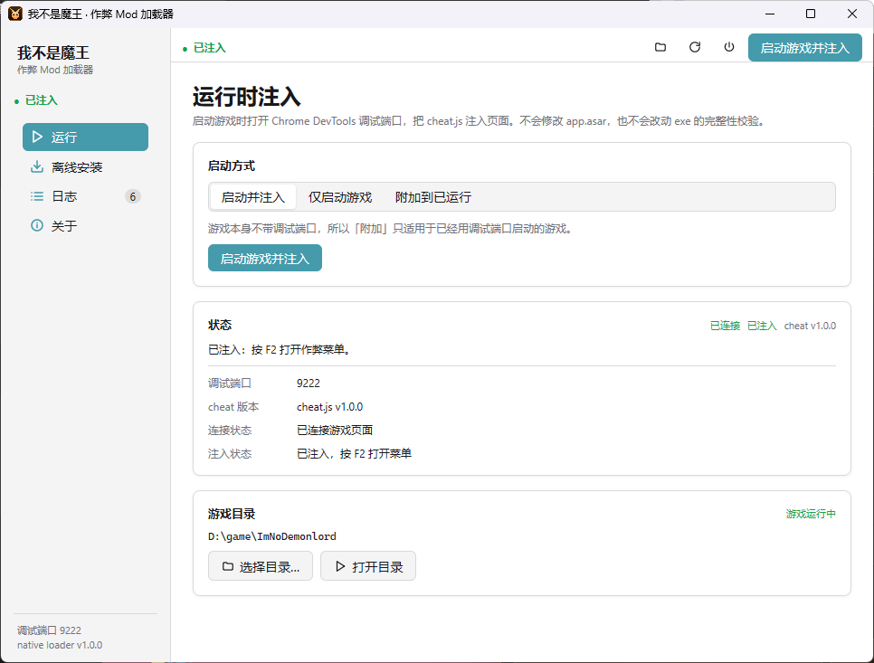
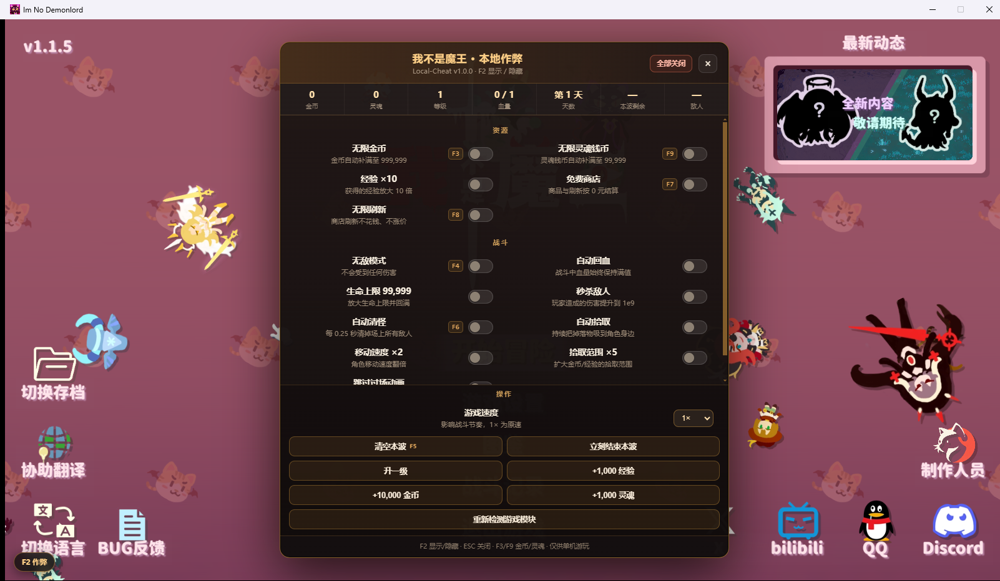
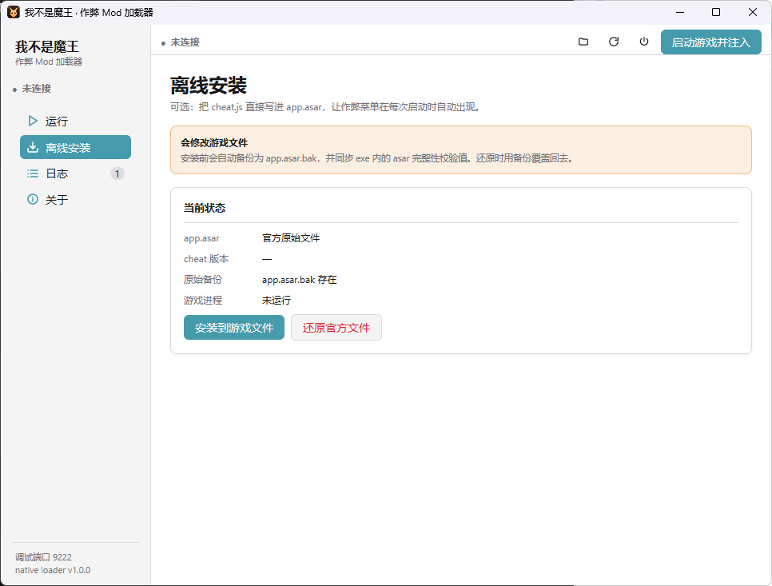

# 安装与还原

<p align="center">
  
</p>

<p align="center"><sub>默认方式：用加载器启动游戏并注入，状态变为「已注入」后按 F2。</sub></p>

## 1. 准备

- Windows 10 / 11 x64。
- 游戏《我不是魔王》Electron 版。游戏根目录必须包含：

```text
ImNoDemonlord.exe
resources\app.asar
```

- 不需要安装 Python、Node.js 或 Go；发布包里的 exe 已经包含全部逻辑。

把发布包解压到任意位置。为了自动定位游戏，推荐解压到游戏根目录下的 `ImNoDemonlord-LocalCheat\`。

首次启动后，加载器会把找到的游戏目录记到：

```text
%AppData%\imnd-loader\config.json
```

## 2. 运行时注入（推荐，不改文件）

1. 双击 `ImNoDemonlord-ModLoader.exe`。
2. 在「运行」页确认「游戏目录」正确；不对就点「选择目录…」。
3. 「启动方式」保持 **启动并注入**，点 **启动游戏并注入**。
4. 加载器会用 `--remote-debugging-port=9222` 启动游戏，等待页面出现并注入脚本。
5. 状态变成 **已注入** 后，进入游戏按 `F2`。

<p align="center">
  
</p>

游戏内重新加载页面后加载器会自动重注入；注入循环在关闭加载器或点工具栏「断开并重连」时结束。

### 附加到已运行的游戏

只有在游戏已经带调试端口启动时才有用：

```bat
ImNoDemonlord.exe --remote-debugging-port=9222
```

然后加载器选 **附加到已运行**，或在命令行执行：

```bat
ImNoDemonlord-ModLoader.exe inject -attach
```

## 3. 离线安装（修改 app.asar）

> 会修改游戏文件。先完全退出游戏（包括后台进程），并确认游戏能正常启动。

### 图形界面

1. 打开 **离线安装** 页。
2. 点 **安装到游戏文件**。
3. 看到「离线安装完成」后，正常启动游戏，按 `F2`。

<p align="center">
  
</p>

<p align="center"><sub>安装前会检查游戏进程；「原始备份」显示 app.asar.bak 是否存在。</sub></p>

安装器会：

1. 如果 `resources\app.asar.bak` 不存在，先把原始 `app.asar` 备份过去（保留最早的原始包）。
2. 读取 asar 文件表，在 `web-mobile/index.html` 的 `</body>` 前插入：

   ```html
   <!-- ImNoDemonlord Local-Cheat -->
   <script src="cheat.js" charset="utf-8"></script>
   ```

3. 写入/更新 `web-mobile/cheat.js`，重新计算该文件的 SHA-256 与分块校验。
4. 重排所有 packed 文件的 offset，原子替换 `app.asar`，再回读校验。
5. 在 `ImNoDemonlord.exe` 的 PE 资源 `INTEGRITY/ELECTRONASAR` 中写入新的 asar 哈希。

任一步失败都会删除临时文件；如果 exe 哈希写失败，会用备份把 `app.asar` 回滚。

### 命令行

```bat
ImNoDemonlord-ModLoader.exe install
ImNoDemonlord-ModLoader.exe install -game "D:\game\ImNoDemonlord"
ImNoDemonlord-ModLoader.exe install -dry-run     :: 只检查
ImNoDemonlord-ModLoader.exe install -force       :: 游戏运行时也写入（不推荐）
```

或直接运行 `install.bat`（可把参数原样传给它）。

### 安装后游戏打不开？

Electron 会校验 `app.asar` 头部的哈希。出现以下情况时，先还原：

```bat
ImNoDemonlord-ModLoader.exe uninstall
```

然后确认 `resources\app.asar` 是原始文件。如果 `ImNoDemonlord.exe` 也被改坏，用游戏平台「校验文件」或重装游戏恢复 exe，再重新安装。

## 4. 还原

### 图形界面

**离线安装 → 还原官方文件**。要求：

- 游戏未运行。
- `resources\app.asar.bak` 存在。

还原会：

1. 用 `app.asar.bak` 覆盖 `app.asar`。
2. 重新计算原始 asar 的头部哈希，并写回 exe 的 `INTEGRITY/ELECTRONASAR`。

### 命令行

```bat
ImNoDemonlord-ModLoader.exe uninstall
```

或运行 `uninstall.bat`。

### 手动还原

如果加载器无法运行：

1. 完全退出游戏。
2. 把 `resources\app.asar.bak` 复制为 `resources\app.asar`。
3. exe 里的哈希会与 asar 不一致，需要用平台校验功能恢复 `ImNoDemonlord.exe`，或重新安装游戏。

所以请始终保留 `app.asar.bak`，直到确认不再需要离线安装。

## 5. 游戏更新

- **运行时注入**：更新后一般直接可用；重新用加载器启动即可。
- **离线安装**：更新前先还原，更新后重新安装。否则：

  - 新版本的 `app.asar` 会被旧备份覆盖（回退游戏内容）；
  - exe 哈希与 asar 不匹配，游戏可能无法启动。

## 6. 卸载加载器

1. 如果有离线安装，先执行 `uninstall`。
2. 删除加载器目录。
3. 可选：删除 `%AppData%\imnd-loader\config.json` 和 `%AppData%\imnd-loader\`。

运行时注入不会在游戏目录里留下文件。

## 7. 故障排查

| 现象 | 原因 / 处理 |
| --- | --- |
| 状态一直「未连接」 | 游戏不是由加载器启动的；完全退出游戏后重开。 |
| 「端口 9222 没有响应」 | 游戏没有调试端口；用「启动游戏并注入」，不要用桌面快捷方式启动。 |
| 注入成功但 `F2` 无反应 | 点一下游戏画面让它获得焦点；关闭输入法的功能键占用。 |
| 安装时提示「游戏正在运行」 | 任务管理器里结束所有 `ImNoDemonlord.exe`；Electron 可能有多个进程。 |
| 安装后启动黑屏/退出 | 哈希未同步或 asar 损坏；执行 `uninstall`，必要时校验游戏文件。 |
| 杀毒软件拦截 | 加载器会写 asar 和 exe 资源；添加信任，或只用运行时注入。 |
| 中文显示为乱码（命令行） | 使用 Windows Terminal / cmd，并执行 `chcp 65001`；图形界面不受影响。 |
