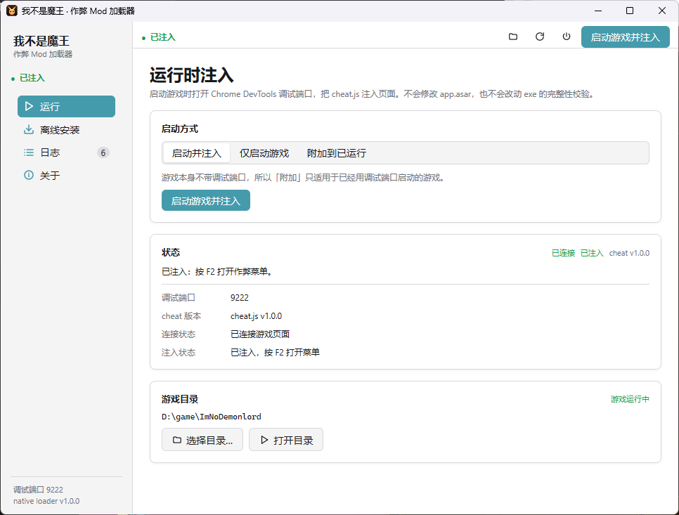
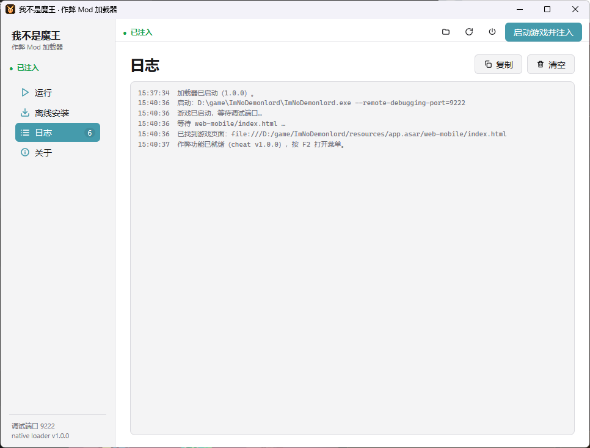
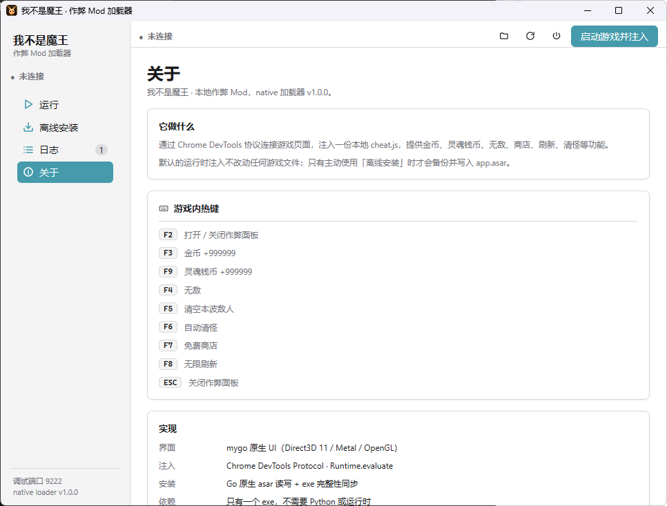

# 加载器与命令行

加载器是一个单文件 Go 程序：`ImNoDemonlord-ModLoader.exe`。默认打开 mygo 原生界面；带子命令时作为 CLI 使用。

<p align="center">
  
</p>

## 命令

```text
ImNoDemonlord-ModLoader.exe [ui]                  打开图形界面
ImNoDemonlord-ModLoader.exe status                查看状态
ImNoDemonlord-ModLoader.exe install               离线写入 app.asar
ImNoDemonlord-ModLoader.exe uninstall             用备份还原
ImNoDemonlord-ModLoader.exe inject                启动游戏并注入（无界面）
ImNoDemonlord-ModLoader.exe help                  显示帮助
```

### status

输出四行：游戏目录、游戏进程状态、asar 安装状态、备份状态、调试端口。

```text
游戏目录：D:\game\ImNoDemonlord
游戏状态：未运行
asar 安装：未安装
原始备份：app.asar.bak 存在
调试端口：9222 未开放
```

### install

把内嵌的 `cheat.js` 写入 `resources\app.asar`。

| 参数 | 说明 |
| --- | --- |
| `-game <目录>` | 指定游戏根目录，默认自动查找 |
| `-dry-run` | 只做读取、解析和注入校验，不写文件 |
| `-force` | 游戏正在运行时也写入（可能导致文件被占用或校验失败） |

退出码：`0` 成功，`1` 失败。

### uninstall

用 `resources\app.asar.bak` 覆盖 `app.asar`，并把原始 asar 的哈希写回 exe。

| 参数 | 说明 |
| --- | --- |
| `-game <目录>` | 指定游戏根目录 |
| `-force` | 游戏运行时也还原 |

### inject

无界面地启动游戏并注入。适合脚本或快捷方式。

| 参数 | 说明 |
| --- | --- |
| `-game <目录>` | 指定游戏根目录 |
| `-port <端口>` | 调试端口，默认 9222 |
| `-attach` | 不启动游戏，注入到已运行且开启调试端口的游戏 |
| `-no-inject` | 只启动游戏，不注入 |
| `-once` | 注入成功后立即退出；否则一直保持注入循环 |

### ui

```bat
ImNoDemonlord-ModLoader.exe ui -game "D:\game\ImNoDemonlord" -port 9222
```

## 图形界面

左侧导航：

- **运行**：启动方式、连接状态、游戏目录。
- **离线安装**：安装/还原、备份状态、进度。
- **日志**：带时间戳的加载器日志，可复制、清空。
- **关于**：热键表、实现说明、仓库链接。

顶部工具栏：

- 状态指示（未连接 / 已连接 / 已注入 / 连接中）。
- 打开游戏目录。
- 断开并重连：结束当前注入循环，重新连接调试端口。
- 关闭全部作弊：调用脚本 API 把所有开关关掉，但保留 `F2` 面板。
- 主按钮：跟随「启动方式」变化。

窗口位置、大小和最大化状态会记住（mygo `StateKey = imnd-loader`）。

<table>
  <tr>
    <td width="50%"></td>
    <td width="50%"></td>
  </tr>
  <tr>
    <td align="center"><sub>日志页：启动、发现页面、注入结果。</sub></td>
    <td align="center"><sub>关于页：热键与实现说明。</sub></td>
  </tr>
</table>

## 配置

```text
%AppData%\imnd-loader\config.json
```

```json
{
  "gameDir": "D:\\game\\ImNoDemonlord",
  "port": 9222
}
```

游戏目录的查找顺序：

1. `-game` 参数
2. 环境变量 `IMND_GAME`
3. 配置文件
4. exe 所在目录及向上 3 层
5. 当前工作目录及向上 2 层

只接受包含 `resources\app.asar` 的目录。

## 环境变量

| 变量 | 说明 |
| --- | --- |
| `IMND_GAME` | 默认游戏目录 |
| `IMND_CHEAT_FILE` | 用外部 `cheat.js` 替换内嵌脚本（调试用） |

示例：

```bat
set IMND_GAME=D:\game\ImNoDemonlord
set IMND_CHEAT_FILE=D:\work\cheat.js
ImNoDemonlord-ModLoader.exe inject -once
```

## 运行时行为

注入流程：

1. 用调试端口启动游戏，附加参数：

   ```text
   --remote-debugging-port=9222
   --disable-backgrounding-occluded-windows
   --disable-renderer-backgrounding
   --disable-background-timer-throttling
   ```

   后三个参数避免窗口被遮挡时 Chromium 把页面标记为 hidden，导致 Cocos 暂停、CDP 调用卡住。

2. 轮询 `http://127.0.0.1:9222/json/list`，找到 URL 包含 `web-mobile/index.html` 的 page target。
3. 连接 `webSocketDebuggerUrl`，启用 `Page`、`Runtime`。
4. `Runtime.evaluate` 执行 `cheat.js`，读取 `window.__IMND_CHEAT_VERSION__` 确认版本。
5. 监听 `Page.loadEventFired`；页面刷新后重新注入。
6. 网络断开时停止，并在界面/日志中报告。

## 构建

```bat
build.bat      :: dist\ImNoDemonlord-ModLoader.exe
package.bat    :: 构建并生成 dist\ImNoDemonlord-LocalCheat-v*.zip
```

链接参数：

```text
-trimpath -ldflags "-s -w -H=windowsgui"
```

- `-H=windowsgui`：GUI 子系统，双击不弹控制台。
- CLI 子命令启动时，若没有可用的 stdout，会 `AttachConsole(ATTACH_PARENT_PROCESS)` 并重开 `CONOUT$` / `CONIN$`；有重定向时保持原句柄，所以 `exe status > out.txt` 仍然有效。

图标与版本资源在 `loader\rsrc_windows_amd64.syso`（已提交）。修改图标后：

```bat
tools\make_winres.bat
```

需要 `go-winres`：

```bat
go install github.com/tc-hib/go-winres@latest
```
