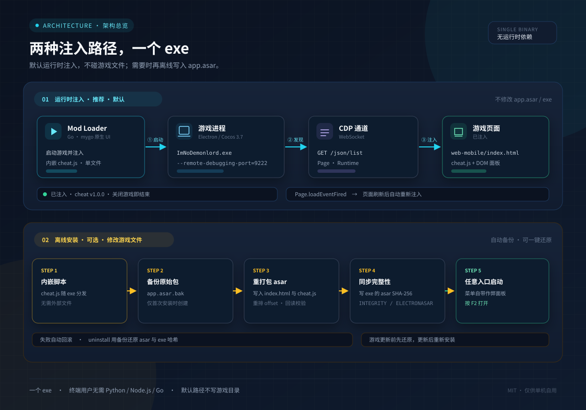

# 原理与逆向笔记

记录这个 Mod 依赖的游戏内部结构，方便游戏更新后重新定位。内容只针对单机自用。

<p align="center">
  
</p>

## 1. 运行时环境

- Electron 桌面程序，页面资源打包在 `resources/app.asar`。
- 渲染层是 Cocos Creator 3.7.3 的 `web-mobile` 构建：

  ```text
  app.asar
  └─ web-mobile\
     ├─ index.html
     ├─ src\...
     ├─ cocos-js\...
     └─ assets\...
  ```

- 游戏页面 URL：

  ```text
  file:///D:/game/ImNoDemonlord/resources/app.asar/web-mobile/index.html
  ```

Electron 默认不开放调试端口，所以运行时注入必须由加载器带上 `--remote-debugging-port=9222` 启动。

## 2. 调试协议

1. `GET http://127.0.0.1:9222/json/list` 返回 target 列表。
2. 选 `type == "page"` 且 URL 包含 `web-mobile/index.html` 的 target。
3. 连接它的 `webSocketDebuggerUrl`，发送：

   ```json
   {"id":1,"method":"Runtime.evaluate","params":{"expression":"...","awaitPromise":true,"returnByValue":true}}
   ```

4. 监听 `Page.loadEventFired`（先 `Page.enable`），页面刷新后重新 `Runtime.evaluate`。
5. 注入完成后读取 `window.__IMND_CHEAT_VERSION__` 校验版本。

不需要 `--remote-allow-origins`：客户端不发送 `Origin` 头。

### 窗口被遮挡后卡死

Chromium 会把被完全遮挡的窗口标记为 `hidden`，Cocos 随之暂停 `requestAnimationFrame`，CDP 的截图和部分调用会挂起。启动时附加：

```text
--disable-backgrounding-occluded-windows
--disable-renderer-backgrounding
--disable-background-timer-throttling
```

## 3. Cocos 模块表

Cocos 3.x 的构建把每个脚本注册进 SystemJS：

```js
System.get('chunks:///_virtual/CharaDataManager.ts')
```

拿到的是模块命名空间，常见形态：

```js
{ CharaDataManager: class {...}, default: ... }
```

所以脚本里统一用：

```js
function mod(name) {
  var ns = System.get('chunks:///_virtual/' + name + '.ts');
  return ns && (ns[name] || ns.default);
}
```

已使用的模块：

| 模块 | 用途 |
| --- | --- |
| `CharaDataManager` | 玩家数据单例：金币、灵魂钱币、生命、移速、拾取范围、经验 |
| `EnemyController` | 敌人受伤入口，用于无敌/秒杀/自动清怪 |
| `BattleShopItem` | 商店购买结算 |
| `UIBattleShopController` | 商店刷新按钮 |
| `TimeScaleUtils` | 全局时间缩放 |

### 货币

```js
var cdm = mod('CharaDataManager').getInstance();   // 具体取法随版本可能不同
cdm.getCurMoney(0);          // 当前金币，参数是货币类型
cdm.tryChangeMoney(+999999); // 增减金币
cdm.getCurInfluence(0);      // 灵魂钱币
cdm.tryChangeInfluence(+999999);
```

脚本不在每一帧硬写数值，而是包装 `tryChange*` 和读取函数，在开关打开时补满，关闭时还原原始行为。

### 原型钩子

```js
function protoHook(proto, name, wrap) {
  var orig = proto[name];
  if (!orig || orig.__imnd) return;
  var fn = wrap(orig);
  fn.__imnd = true;
  proto[name] = fn;
}
```

用于：

- `CharaDataManager.prototype.expUp` → 经验倍率
- `CharaDataManager.prototype.getMaxHp` → 生命上限
- `CharaDataManager.prototype.getMoveSpeed` → 移速
- `CharaDataManager.prototype.getCollectScale` → 拾取范围
- `EnemyController.prototype.damaged` → 无敌 / 秒杀
- `BattleShopItem.prototype._onClickItemBuy` → 免费购买
- `UIBattleShopController.prototype._onClickRefreshButton` → 免费刷新

关闭功能时通过 `prev` 记录的值恢复；页面刷新后钩子随旧页面一起消失，不会重复叠加。

## 4. 面板

- 一个 `position: fixed` 的根节点，`z-index` 高于 Cocos canvas。
- 面板本身用 DOM + CSS，不参与 Cocos 渲染，所以不受分辨率和缩放影响。
- 键盘监听在 `window` 的捕获阶段，`preventDefault()` 阻止游戏同时响应功能键。
- `F2` / `ESC` 切换显示；其余热键直接调用对应开关。
- 启动时清理上一次运行残留的存档标记，避免状态互相污染。

## 5. app.asar 格式

asar 是「16 字节 pickle 头 + JSON 文件表 + 数据区」：

```text
0x00  uint32  4
0x04  uint32  pickle 大小
0x08  uint32  payload 大小（JSON 长度 + 对齐填充）
0x0C  uint32  JSON 长度
0x10  JSON    文件表
...   填充到 4 字节
...   文件数据（按 offset 依次排列）
```

文件表把目录表示成 `{"files": {...}}`，文件是：

```json
{
  "size": 1234,
  "offset": "0",
  "integrity": {
    "algorithm": "SHA256",
    "hash": "...",
    "blockSize": 4194304,
    "blocks": ["..."]
  }
}
```

`unpacked: true` 的文件不在 asar 里，而在 `app.asar.unpacked/`。

### 重打包

`loader/asar.go` 的做法：

1. 深拷贝文件表，避免污染原始解析结果。
2. 用一个有序的 leaf 切片遍历所有 packed 文件。

   **Go 的 map 遍历顺序是随机的**，所以 offset 布局和写数据必须共用同一个切片，否则文件内容会错位。

3. 修改目标条目的 `size` 和 `integrity`。
4. 重新分配 offset，`unpacked` 条目删除 offset。
5. 写新头、写数据：未修改的文件从旧 asar 按旧 offset 逐字节复制，修改的写新内容。
6. 每写一个文件都校验当前写入位置与 `dataStart + offset + size` 一致。
7. 写到 `app.asar.tmp`，回读校验后原子改名。

## 6. exe 完整性校验

Electron 的 asar integrity fuse 会把 asar 头的 SHA-256 固化在 exe 的 PE 资源里：

```text
INTEGRITY
└─ ELECTRONASAR        "alg":"SHA256","value":"<64 hex>"
```

注意：

- 哈希的对象是 **asar 头 JSON 的原始字节**，不是整个 asar 文件。
- 资源是 UTF-8/ASCII 文本，加载器按 `"alg":"SHA256","value":"` 定位，再确认前面 300 字节内出现 `app.asar`，避免误匹配。
- 安装时先确认资源存在，再替换 asar；写 exe 失败则用备份回滚 asar。
- 还原时用备份 asar 的头哈希写回，所以 exe 能恢复到原始值。

验证方法：

```bat
ImNoDemonlord-ModLoader.exe status
```

安装后 `asar 安装：已安装`，还原后 `原始备份：app.asar.bak 存在` 且游戏可正常启动。

## 7. 工程上的坑

| 坑 | 处理 |
| --- | --- |
| Go map 顺序随机 | 单一有序 leaf 列表同时用于布局与写入 |
| 覆盖已存在文件 | 先写 `.tmp`，`Sync`，再 `Rename` |
| exe 与 asar 不同步 | 先检查完整性资源，失败即回滚 |
| GUI 子系统没有 stdout | `AttachConsole(ATTACH_PARENT_PROCESS)`；有重定向则保留原句柄 |
| 双击弹出控制台 | 链接 `-H=windowsgui` |
| 窗口被遮挡导致页面暂停 | 三个 `--disable-*` 启动参数 |
| 页面刷新丢失注入 | 监听 `Page.loadEventFired` 重注入 |
| 多次注入重复挂钩 | `window.__IMND_CHEAT__` 哨兵 |

## 8. 边界

- 只修改本地单机进程的内存与本地文件，不涉及网络协议。
- 不绕过任何在线校验，也不修改服务器数据。
- 游戏更新可能改变模块名、方法名和 asar 布局；届时 `status`、日志页和 `-dry-run` 是最先要看的三个入口。
